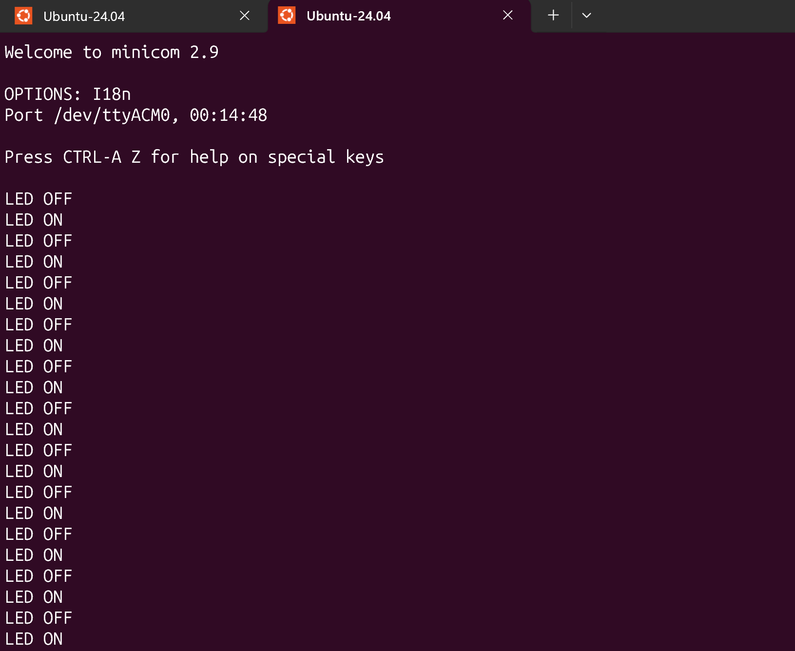

# 01-blinky

Toggles LD2 every 500 ms and prints the state over the ST-LINK virtual COM port.

```bash
cd ~/zephyrproject/zephyr-learning
west build -p always -b nucleo_f401re apps/01-blinky
west flash --runner openocd
minicom -D /dev/ttyACM0 -b 115200
```

## Things to try

- Change `SLEEP_TIME_MS` and reflash.
- Open `build/zephyr/zephyr.dts` and find where the `led0` alias points.
- Look at `build/zephyr/.config` and search for `CONFIG_GPIO`.

## Demo

Console output over the ST-LINK virtual COM port (`minicom -D /dev/ttyACM0 -b 115200`):


